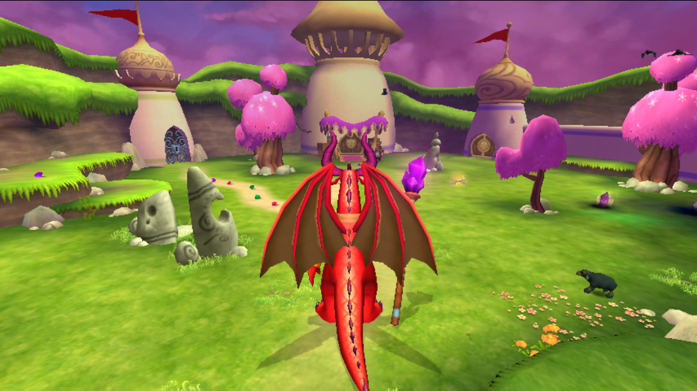
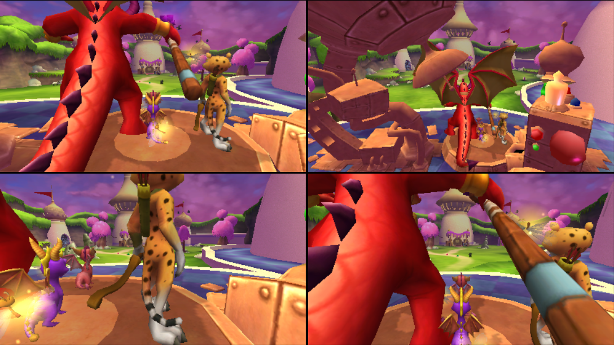
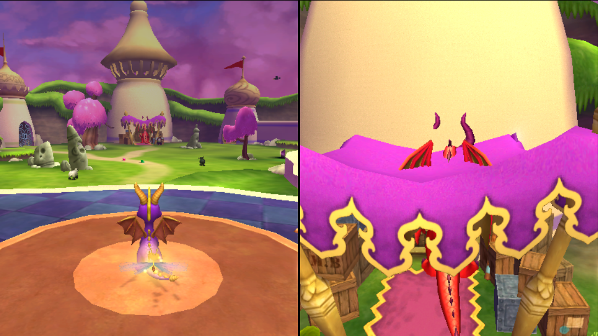
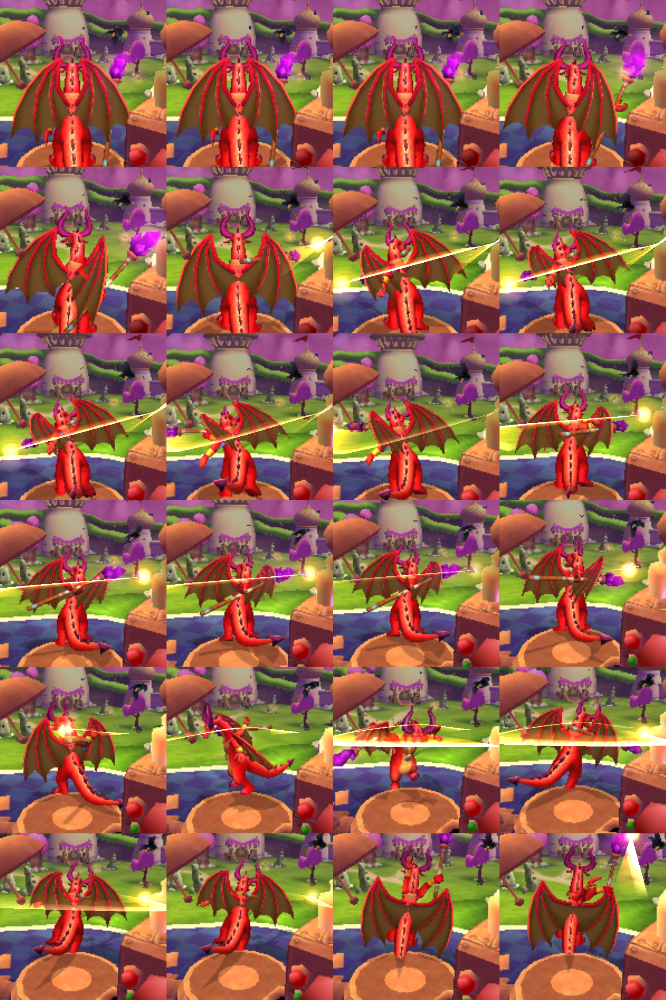
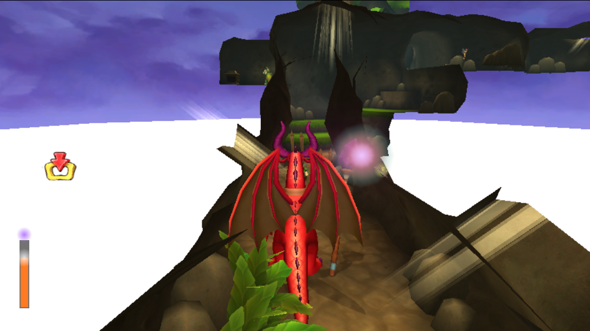
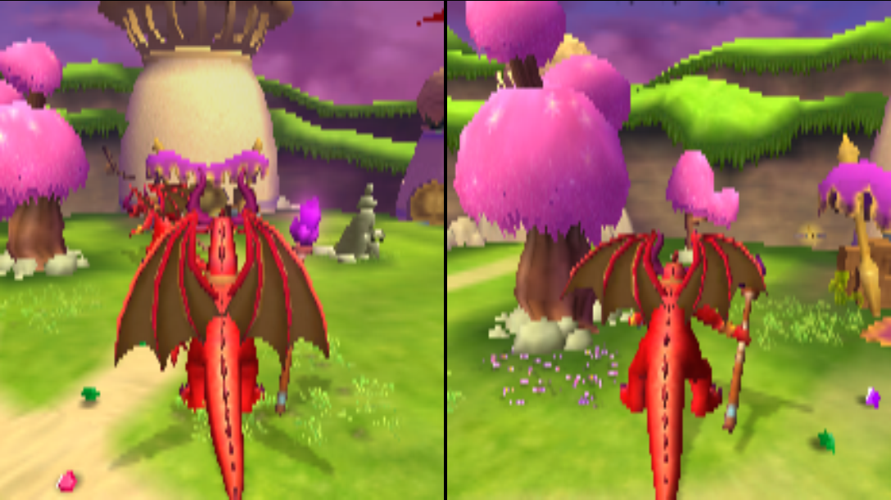
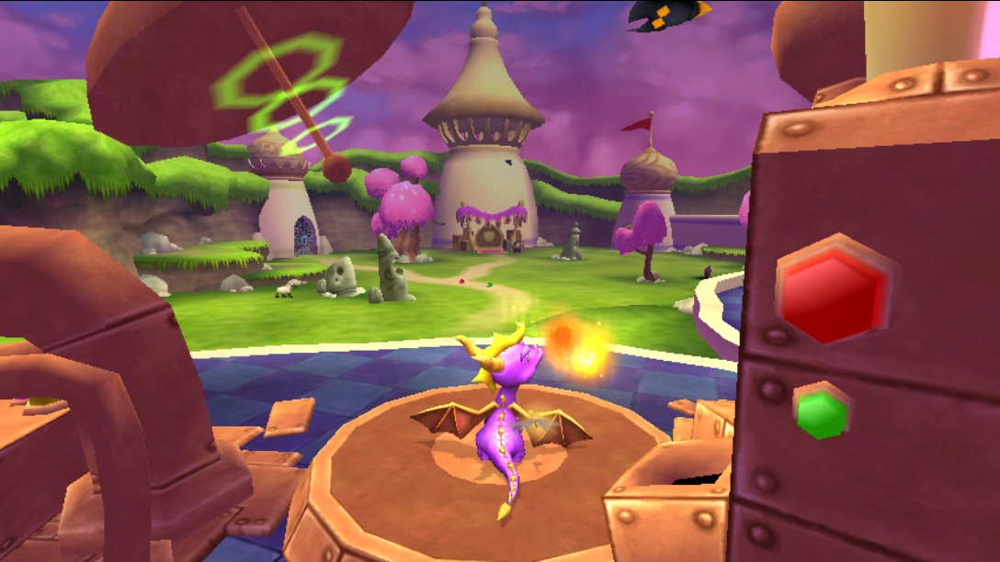
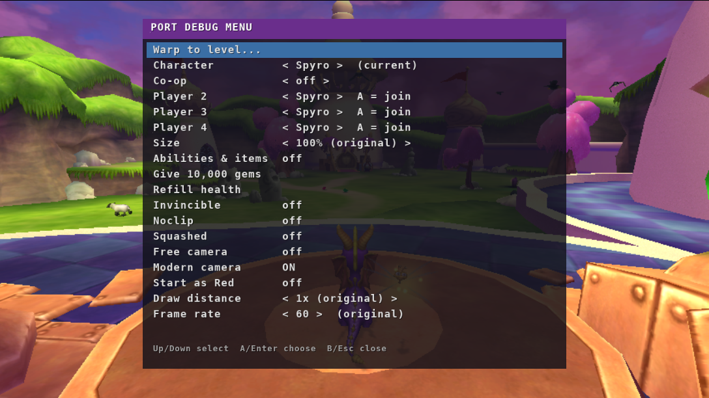
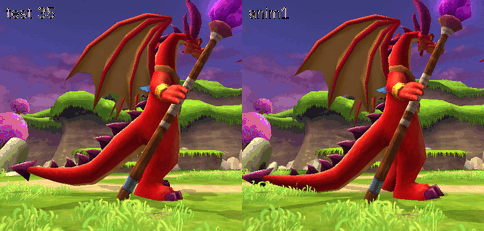

# Spyro: A Hero's Tail — native PC port (bring your own game)

A loader that runs the original **Xbox** release of *Spyro: A Hero's Tail* natively on a PC, with
widescreen, high frame rates, a debug menu, **Red as a playable character**, and **split-screen
co-op for up to four players**.

It is not an emulator. `xboxrun` maps the game's own `default.xbe` into memory and runs its x86
code directly on the CPU. The Xbox kernel, Direct3D 8 (NV2A), DirectSound and the controllers
are replaced with OpenGL 3.3 and SDL2 code.

**No game files are included.** You need your own copy of the game: see
[Bring your own game](#bring-your-own-game).



## Features

| | |
|---|---|
|  |  |
| **Co-op for 2–4 players.** Each player has their own controller, camera, Sparx and character, Red included. Two players split the screen left and right; three or four get quarters. | **Any character for anyone**: Spyro, Hunter, Sparx, Blink, Sgt. Byrd, Ball Gadget, Ember, Flame or Red. |
|  |  |
| **Play as Red.** He has his own walk, run, jumps, double jump and flight, a four-hit staff combo with slash trails, aimed and charged spells for every breath element, a ground pound, a tail-spin, a wing shield, and a **shrink bolt** (Y) that shrinks enemies so you can jump on them. | **Red's magic meter** and staff glow. His voice lines and staff sounds come from his own boss-fight sound bank. |
|  |  |
| **Several Reds at once.** Each one has his own moves, magic and effects. | **Character size** from 0.1% to 200%. The hitbox, movement and camera all scale with it. |
|  |  |
| **Debug menu** (F1 or L3+R3): warp to any level, change character, set up co-op, size, cheats, noclip, free camera, modern camera, draw distance and frame rate. | Red's hand-made walk and run cycles. |

The port also has:
- native 16:9 widescreen, rendering at your desktop resolution;
- frame rates from 60 up to 244;
- a draw distance up to 16 times the original;
- the in-game movies (.xmv), with sound;
- saves;
- any controller SDL recognises, or the keyboard.

The full controls and debug-menu guide is in [docs/PLAYING.md](docs/PLAYING.md).

## Platforms

| Platform | Status |
|---|---|
| **Linux** (x86-64) | Native. Build it from source, or use the prebuilt AppImage in `prebuilt/`. |
| **Windows 10/11** | Through **WSL2**, Windows' built-in Linux; there is no native .exe. `windows\Install-Spyro.bat` sets everything up and makes a desktop shortcut. See [docs/WINDOWS.md](docs/WINDOWS.md). |
| **macOS** | Intel Macs only, inside a Linux virtual machine. Apple Silicon is not supported. See [docs/MAC.md](docs/MAC.md). |

Why not native Windows or Mac builds? The game's code is 32-bit x86 and runs directly on the CPU.
The loader uses Linux features to make that work: fixed low memory addresses, its own `fs`
segment for the Xbox's thread data, and signal handlers for the instructions the Xbox allows but
a PC user program doesn't. Current macOS can't run 32-bit x86 code at all, and Apple Silicon
isn't x86.

## Bring your own game

You need **Spyro: A Hero's Tail for the original Xbox, NTSC-U (USA)**: title ID `56550034`, the
version this port was made for. Other regions aren't supported, because the mods patch the game
at fixed addresses.

1. **Make an image of your own disc.** A normal PC DVD drive can't read Xbox discs. The usual
   ways are:
   - FTP the game off a softmodded Xbox;
   - dump it with a Kreon-firmware drive, which gives a full "Redump" image.

   Either an `.iso` (XISO) or the extracted files works.
2. **Install an extractor.** Use either one:
   - [`extract-xiso`](https://github.com/XboxDev/extract-xiso). If your distro doesn't package it,
     `tools/get-extract-xiso.sh --deps` builds it into `~/.local/bin`;
   - [`xdvdfs`](https://github.com/antangelo/xdvdfs), installed with `cargo install xdvdfs-cli`.
     It also reads full Redump images.
3. **Extract and check** with the included script:
   ```sh
   ./setup-game.sh "/path/to/Spyro A Hero's Tail.iso" ~/games/spyro
   ```
   It extracts the image, then checks that the port's files are there:
   ```
   default.xbe
   Spyro/Binary/_bin_XB/BuildData/Filelist.bin
   Spyro/Binary/_bin_XB/BuildData/Filelist.000
   Spyro/Binary/_bin_XB/BuildData/Filelist.001
   Spyro/Binary/_bin_XB/BuildData/Filelist.002
   *.xmv   (movies, optional)
   ```
   If you already have the files from a softmodded Xbox's FTP, point the script at the folder
   instead: `./setup-game.sh ~/games/spyro`. The loader also finds files by name anywhere in
   the game folder, so the exact layout doesn't matter.

## Build

On a 64-bit x86 Linux system (Debian/Ubuntu, Fedora or Arch):

```sh
git clone https://github.com/JackyPendrag0n/spyro-heros-tail-pc-recomp && cd spyro-heros-tail-pc-recomp
./build.sh --deps        # installs the 32-bit compiler, SDL2 and OpenGL packages (sudo), then builds
./build.sh --appimage    # optional: also pack dist/spyro-heros-tail-x86_64.AppImage
```

- The output goes in `dist/`: `xboxrun`, `run.sh` and `default.xbsym`. Keep the three together.
- The first build also compiles a small static 32-bit **ffmpeg** for the movies. It downloads
  the ffmpeg 6.1.1 source and takes a few minutes.
- `./build.sh --clean` removes the build output.

Requirements:
- glibc 2.34 or newer;
- `vm.mmap_min_addr` at most 65536, which is the Linux default;
- a GPU driver with 32-bit OpenGL 3.3. If Steam runs, you have one.

## Run

```sh
dist/run.sh ~/games/spyro
# or
prebuilt/spyro-heros-tail-x86_64.AppImage ~/games/spyro
```

- `run.sh` finds the game folder and checks for the 32-bit libraries. If any are missing, it
  prints the install command for your distro.
- The log goes to `xboxrun.log` next to the script or AppImage.
- Saves go to `xbox_hdd/` next to the game folder.
- The first time you play as Red, the port records his animations from the game's data. That
  takes about half a minute.

Common options:

| Variable | Effect |
|---|---|
| `XBOX_FPS=144` | Frame rate. |
| `XBOX_SCALE=2` | Internal resolution in multiples of 480 lines. |
| `XBOX_WIDESCREEN=0` | 4:3. |
| `XBOX_COOP=1 XBOX_COOP_PLAYERS=4` | Start with co-op on. |

The full list is in [docs/PLAYING.md](docs/PLAYING.md).

## Known limits

- **Co-op:**
  - Health and lives are shared.
  - Only player 1's Start pauses.
  - The HUD is drawn in each view.
  - Players 2–4 sit out the Ball Gadget runs and the mini-games, which are built for one
    player, and come back next to player 1 afterwards.
- **Character changes inherited from the GameCube CharacterChanger mod:**
  - The Ball Gadget crashes if it talks to someone.
  - Anyone but the Ball Gadget crashes in a Ball Gadget hole.
  - Hunter crashes against the special Crocovile in Crocovile Swamp.
- **Above 60 fps,** frame-counted waits run faster, for example the logo screens.
- **Free camera:** the game still culls from its own camera, so distant scenery can disappear.

## How it works

[docs/ENGINEERING-NOTES.md](docs/ENGINEERING-NOTES.md) is the full engineering log. It covers:
- every reversed address and structure;
- how the graphics pipeline is translated (vertex microcode and register combiners to GLSL);
- how Red, co-op and the other mods hook the game.

Source layout:
- `loader/main.c`, `xbe.c`, `k*.c`, `thread.c`: boot, kernel emulation;
- `loader/gfx/`: Direct3D to OpenGL;
- `loader/debugmenu.c`: the debug menu and most mods;
- `loader/red*.c`: playable Red;
- `loader/coop.c`, `loader/redctx.c`: co-op;
- `tools/`: archive, XBE and build helpers.

## Legal

This is a fan project, not affiliated with or endorsed by Activision or Eurocom. It contains no
game code or data: you supply your own legally made copy. *Spyro* is a trademark of Activision.
